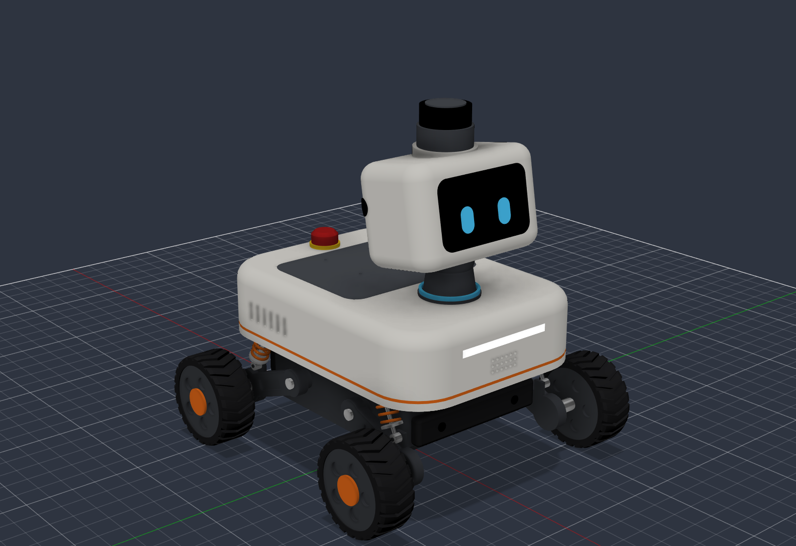

# Sprocket body

A four-wheel-drive rover with independent suspension, a face display and the lidar on top of the head.
360 × 343 × 386 mm, about 7.5–8 kg (estimate from the parts list, not weighed).

| File | What it is |
| --- | --- |
| `sprocket_body.py` | The generator. Every dimension is a constant at the top; `build()` rebuilds the model in Fusion. |
| `sprocket_body.f3d` | Fusion archive of the last build (components, bodies, colours). |
| `sprocket_body.step` | The same model for any other CAD tool. |
| `renders/` | Views of the last build, including `inside.png` with the shells hidden. |

Axes: X forward, Y left, Z up, origin on the ground under the middle of the wheelbase.

## Layout

| Zone | Height above ground | What lives there |
| --- | --- | --- |
| Tub (aluminium) | 45–118 mm | Battery low and central, power board, motor bus hub |
| Deck plate | 118–122 mm | The structural floor: shock towers, computer and shell bolt to it |
| Under the shell | 122–189 mm | VENTUNO Q with fan, IMU at the robot's centre, DC-DC, RS-485 adapter, speaker, microphone array under the hatch |
| Neck | 192–232 mm | Cable duct with a status light ring |
| Head | 225–342 mm, tilted 10° up | Display behind a tinted visor, front camera above it, two rear cameras in the back corners at ±120° |
| Lidar | scan plane about 375 mm | Highest point, level, nothing in its view |

## Parts

| Part | Choice | Envelope in the model (mm) |
| --- | --- | --- |
| Computer | Arduino VENTUNO Q, fed from the battery on its 7–24 V screw terminal | 160 × 100 × 25.8 plus fan |
| Drive | 4 × direct-drive hub motor, Waveshare DDSM115 (18 V, 0.96 N·m rated, 200 rpm no load, IP54, RS-485, encoder inside) | Ø100 × 40 tyre |
| Suspension | 4 × trailing arm, 85 mm pivot to axle, with a 90 mm coil-over; ±20 mm wheel travel | |
| Battery | 5S2P 21700 Li-ion, 18 V 10 Ah (180 Wh) with BMS | 120 × 78 × 50 |
| Lidar | RPLIDAR C1 (2D, 12 m) | Ø56 × 41 |
| Cameras | 3 × wide-angle MIPI-CSI (the board has three CSI connectors) | 25 × 24 boards |
| Display | 3.5 in IPS 480 × 320 SPI | 92 × 56 × 6 |
| Microphones | ReSpeaker XVF3800 4-mic array | Ø100 × 8 |
| Speaker | 36 mm, 5 W | Ø36 × 28 |
| IMU | BNO085 | 24 × 20 × 5 |
| Ground sensors | 2 × ToF (VL53L7CX class) in the front bumper, looking down for kerbs and steps | |
| Safety | Latching e-stop on top (cuts motor power only), rubber bumpers front and rear | |
| Charging | Socket and two dock contacts at the rear | |

## Checked and not checked

- Fusion's interference analysis over all 91 bodies reports no overlaps.
- Not from a drawing, so confirm before cutting metal: the DDSM115's shaft and tyre width, the microphone
  board's outline (sources give 99 mm round and 108 mm square), and the VENTUNO Q's mounting holes (the standoff
  positions are placeholders).
- Spring rate, damping and travel are design targets; nothing has been simulated or loaded.
- This is a packaging and styling model: no fasteners, wiring, seals or snap fits yet.
