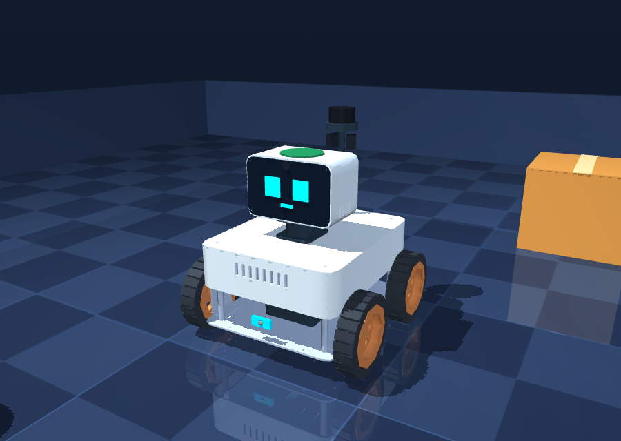

# Sprocket on the Arduino VENTUNO Q

The VENTUNO Q has two computers on one board, and the robot uses them the way professional mobile robots
split their work: everything that must happen on time runs on the microcontroller, everything that thinks
runs on Linux, and the Linux side is itself split so that thinking can never delay steering.



## The board

| Part | What it is | What the robot uses it for |
|---|---|---|
| Qualcomm Dragonwing IQ8 (IQ-8275) | 2x Cortex-A78C 2.35 GHz, 2x A78C 2.1 GHz, 4x A55 1.95 GHz | control, perception, the language model, everything else (see the core plan) |
| Adreno 623 GPU, Hexagon NPU (40 TOPS INT8) | | not used yet (llama.cpp's OpenCL backend is a build option; NPU detector export is future work) |
| 16 GB LPDDR5-6400, 64-bit | ~51 GB/s | model size is cheap in memory but not in speed: decoding is bandwidth-bound |
| STM32H5F5 (Cortex-M33, 250 MHz, Zephyr) | the real-time controller | `firmware/ventuno_mcu`: wheels, odometry, reflexes, watchdog |
| Arduino Router | msgpack-RPC between the two | `robot/body/mcu_body.py` over `/var/run/arduino-router.sock` |

## Layers and rates

```
 STM32H5 (firmware/ventuno_mcu)                                 hard real time, never waits for Linux
   200 Hz  encoders -> wheel speed PI (+feed-forward, anti-windup) -> PWM
   200 Hz  odometry: distance from encoders, heading from the gyro (bias re-learned at rest)
   200 Hz  safety envelope: forward speed <= sqrt(2 a d) to the range reading; bumper / cliff / lifted /
           stall / e-stop latch the motors; 300 ms command watchdog
    50 Hz  telemetry -> Linux                       ^ cmd_vel 50 Hz
 ------------------------------------------------- | -------- Arduino Router (msgpack-RPC) ----------
 Linux, one Python process                         |
   control thread   50 Hz, SCHED_FIFO 60, fast core: behaviour tick -> collision monitor -> cmd_vel
   perception thread  camera -> YOLO (NCNN) -> map; lidar scan -> occupancy grid; other fast core
   main event loop  cognition (agent, skills, memory), speech, dashboard; the A55 cores
 llama-server (own process, sprocket-llm.service): the two 2.1 GHz A78 cores
```

Why each split matters, measured on the laptop with `scripts/bench_control.py` (sim robot driving a
continuous loop at 50 Hz while the main event loop is hit by 30 ms bursts of Python work, as a model reply
being parsed does):

| | control in the main loop (before) | control + perception threads (now) |
|---|---|---|
| achieved control rate (target 50 Hz) | 24.7 Hz | 48.8-49.1 Hz |
| median start lateness | 11.9 ms | 0.5 ms |
| worst lateness | 75-122 ms | 29 ms |
| detector rate | 8 Hz | 33 Hz |
| same, no load: rate / missed deadlines | 27.6 Hz / 94 | 50.7 Hz / 0 |

The remaining 20-30 ms tail under load is the interpreter lock: on Windows a waiting thread's wake-ups land
on the 15.6 ms system timer tick. Linux hands the lock over at the 1 ms switch interval that
`tune_process` sets, so expect a shorter tail on the robot; measure it there with the same script.
Either way the microcontroller keeps executing the last command inside its own braking envelope, so a
late supervisory tick costs smoothness (8 mm of travel at 0.4 m/s), never safety.

### Core plan (`robot/core/realtime.py`)

Derived at start-up from the frequencies the kernel reports, so it adapts to other boards:

| cores | what runs there |
|---|---|
| A78 2.35 GHz #1 | control thread (SCHED_FIFO 60, pinned) |
| A78 2.35 GHz #2 | perception thread (camera, detector, lidar fusion) |
| A78 2.1 GHz x2 | llama-server (`CPUAffinity` in `sprocket-llm.service`, 2 threads) |
| A55 x4 | the main event loop: cognition glue, speech, dashboard |

Process tuning (`perception.tune_process`): the garbage collector's view of the start-up heap is frozen and
full collections made rare (they were multi-millisecond pauses), the interpreter lock is handed over every
1 ms instead of 5 ms, and memory is locked (`mlockall`) so the control path never page-faults after the
model server pushed it out.

## Localization

Odometry drifts (skid steer slips in every turn), and everything the robot knows is placed with that pose.
`robot/world/localization.py` matches each lidar scan against the occupancy grid (correlative scan
matching: +-80 mm in 20 mm steps, +-3 degrees in 1 degree steps, ~180 points) on the perception thread
and folds the result into a map <- odometry correction; `LocalizedBody` hands every other part the
corrected pose. Corrections are applied only where the map has structure under the scan and the match beats
"no change", and only half of each match is applied.

Measured on the MuJoCo physics body (wheel slip, noisy encoders and gyro), 10 waypoint legs in 60 s
(`scripts/bench_localization.py`): odometry 49 mm / 2.2 degrees off the true pose at the end, corrected
pose 31 mm / 0.7 degrees; worst during the run 63 mm vs 42 mm.

## Safety, in depth

1. **Microcontroller** (always on, independent of Linux): braking envelope from the range sensor, reflex
   latches, stall detection (driving hard, wheels not turning, 0.6 s), watchdog.
2. **Collision monitor** (`robot/control/safety.py`, every control tick): lidar points all around plus the
   range reading. In the direction of travel the speed is capped to what still stops `margin` short,
   reaction time included; in-place turns slow down when something brushes the turning circle. Backing
   into a wall now stops short of it (the range sensor faces forward; before, only the bumper caught it).
3. **Behaviours** plan around the map (A* on the occupancy grid the lidar fills) and re-plan on blocks.

## Bring-up

1. Wire the base to the MCU header (motor driver, encoders, VL53L1X, IMU, bumpers, cliff sensors, head
   servo, e-stop, battery divider, dock contacts). Map the `PIN_*` constants at the top of
   `firmware/ventuno_mcu/ventuno_mcu.ino` to your header; the rest of the constants come from
   `config/body.yaml`.
2. Flash the sketch from Arduino App Lab (or `arduino-cli`), with the libraries `Arduino_RouterBridge`,
   `VL53L1X` (Pololu) and `Adafruit MPU6050`.
3. On the board: `bash scripts/ventuno/setup.sh` (packages, llama.cpp, the model, Python, udev rule for the
   lidar, CPU governor, services). `LLAMA_BACKEND=opencl` also builds the Adreno OpenCL backend.
4. Check the link with the wheels off the ground:
   `~/robot-runtime/venv/bin/python scripts/ventuno/mcu_check.py --wiggle` (telemetry should be ~50 Hz).
5. `sudo systemctl start sprocket-llm sprocket`; logs with `journalctl -u sprocket -f`. The control thread's
   timing (late p50/p99, overruns) and the collision monitor's verdict are in the fast loop's health
   details and on the dashboard.

## Not verified yet

Nothing here has run on a VENTUNO Q: the firmware compiles against the documented Router Bridge API
(`Bridge.provide_safe`, `Bridge.notify`) and the Linux side against the router's msgpack-RPC protocol
(`$/register`, notifications), both as published for the UNO Q, but neither has met the real board.
Expect to adjust pins, encoder directions, gains (`KFF`, `KP`, `KI`) and the camera pipeline
(`robot/perception/camera.py` tries Qualcomm's `qtiqmmfsrc`, then `libcamerasrc`; which one the board's
Ubuntu/Debian image ships is not confirmed; `runtime.camera: usb` is the safe start).
